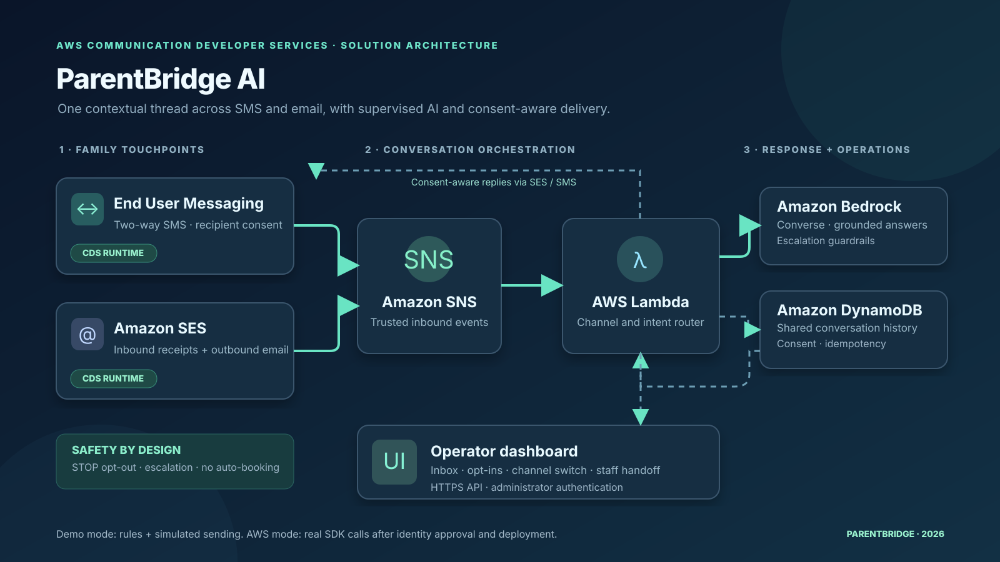

# ParentBridge AI

**An omnichannel conversation assistant for school-family engagement using AWS Communication Developer Services (CDS).**

ParentBridge AI keeps the context of a family conversation together when it moves between SMS and email. It supports AI-assisted intent detection, staff escalation for sensitive or consequential requests, explicit channel consent, and a responsive operator dashboard.

> **Honest demo statement:** Local preview uses **deterministic rules and simulated delivery**, not Amazon Bedrock or live CDS sending. AWS deployments call **Amazon SES v2**, **AWS End User Messaging SMS** and, when configured, **Amazon Bedrock Converse**. AWS deployment, service approval and a verified partner identity are separate prerequisites. The project has not been claimed to be deployed by this package.



## Features

- **One persistent conversation:** e.g., parent replies to a school SMS, requests an email recap, and receives the response via email in the same DynamoDB thread.
- **Real CDS runtime adapters:** `src/channels.py` actually calls `boto3.client('sesv2').send_email(...)` and `boto3.client('pinpoint-sms-voice-v2').send_text_message(...)` when AWS mode and real sends are explicitly enabled.
- **Real inbound message handling:** AWS SNS receives two-way SMS and SES inbound receipt notifications; `src/handler.py` processes them and unifies context.
- **AI orchestration:** Amazon Bedrock Converse (`src/agent.py`) with constrained school facts and deterministic fallback when unavailable.
- **Consent first:** No messaging without channel consent; STOP opt-out; unknown inbound contacts are never auto-enrolled.
- **Human handoffs:** Safety, payments, transport, attendance and unconfirmed bookings are escalated rather than automatically acted on.
- **Secure operations:** Protected AWS API, no real transport in local mode, SNS idempotency and no embedded credentials.
- **Accessible interface:** Responsive messaging dashboard, keyboard support, clear demo status, no third-party tracking.

## Run the working local demo

Requires **Python 3.10+**. The demo uses only Python's standard library and does **not** require AWS credentials.

```bash
python -m src.server --port 8787
```

Then open **http://127.0.0.1:8787**. Try these steps:

1. Open Maria Ahmed's conversation.
2. Select *Simulate parent reply* → SMS and enter `Can you send the homework resources by email?`.
3. Send `switch to email`; the next reply arrives in the same thread, now tagged **EMAIL**.
4. Enter `My child has an allergy. Is the food safe?`; a human handoff is flagged instead of an invented answer.
5. Select *School announcement* and send an approved message (simulated, no external delivery).
6. Open *Insights* and *Family directory* to see conversation metrics and opt-in states.

Run automated tests:

```bash
python -m pytest -q
```

## Deploy on AWS (required for hackathon eligibility)

Deployment needs an AWS account with SES verification, an eligible SMS origination identity if using SMS, and an enabled Bedrock model. The implementation uses AWS SAM. Follow [docs/DEPLOYMENT.md](docs/DEPLOYMENT.md).

```bash
pip install -r requirements.txt
sam build
sam deploy --guided
```

SAM provisions API Gateway HTTP API, AWS Lambda, encrypted DynamoDB, and an SNS inbound topic. The receipt rule and inbound phone-number routing require one-time account-side configuration. Real delivery is **off by default**. Do not enable it until the originating identities and recipients are appropriately approved and consent is documented.

## Project layout

```text
src/agent.py       Grounded Bedrock Converse agent + transparent fallback
src/channels.py    Real SES v2 and End User Messaging SMS API calls
src/core.py        Thread context, routing, consent, escalation
src/store.py       Demo in-memory store and AWS DynamoDB store
src/handler.py     HTTP API + inbound SNS handler
src/server.py      Offline local demo server
web/               Responsive single-page dashboard
template.yaml      AWS SAM deployment architecture
tests/             Unit + integration tests with AWS client mocks
assets/            Architecture diagram
docs/              Deployment, privacy, demo script, submission notes
```

## Limitations and production hardening

- The product is a **hackathon prototype**, not a live school information system. Fictional sample data only. No FERPA/GDPR production assessment has been conducted.
- A production launch requires tenant isolation, recipient identity verification, staff queue operations, observability, deliverability workflows, rate limits, data retention and deletion, abuse controls, regional compliance, and independent security review.
- Current staff handoffs are represented as flags for review, not as confirmed external support tickets.
- SES inbound SNS actions can carry messages up to documented size limits; attachments and HTML-only emails are intentionally not processed.
- SMS two-way availability and origination approvals vary by region and country.
- Deployment costs can apply. Do not test with real families or unconsented destinations.

## References

- [Amazon SES v2 SendEmail](https://docs.aws.amazon.com/boto3/latest/reference/services/sesv2/client/send_email.html)
- [AWS End User Messaging SMS SendTextMessage](https://docs.aws.amazon.com/boto3/latest/reference/services/pinpoint-sms-voice-v2/client/send_text_message.html)
- [AWS two-way SMS SNS payload](https://docs.aws.amazon.com/sms-voice/latest/userguide/two-way-sms-payload.html)
- [SES receiving SNS notifications](https://docs.aws.amazon.com/ses/latest/dg/receiving-email-notifications-contents.html)
- [Amazon Bedrock Converse](https://docs.aws.amazon.com/boto3/latest/reference/services/bedrock-runtime/client/converse.html)

## License

MIT — see [LICENSE](LICENSE).
